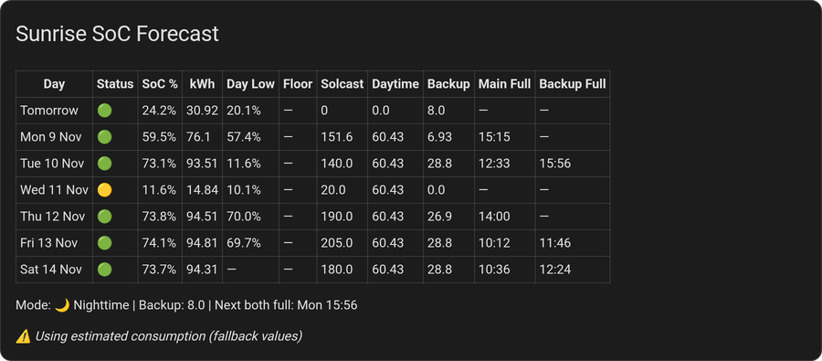

# Sunrise SoC Forecast for Home Assistant

Predicts your battery's state of charge (SoC) at sunrise for tomorrow and up to six more days, and the time of day your batteries will be full. Built for off-grid and battery-first homes: it tells you before dark whether tonight is covered, which mornings will be tight, when a dump load can run and when to charge from the grid.

It works with any inverter or battery that exposes a SoC sensor and a house-load power sensor in Home Assistant, and takes its solar forecast from Solcast or Open-Meteo Solar Forecast.

## What It Does

Every day, this integration answers one question: **what will my battery be at when the sun comes up?** — and its companion: **when will the batteries be full?**

It runs a simulation forward from your battery's current state: the solar forecast goes in, your own measured consumption comes out, and a backup battery and dump loads are modelled if you have them. For each of the next 7 sunrises it reports the SoC, the grid import needed to hold your target, and the time the main (and backup) battery reach 100 %. From Day 2 on, each day also reports the lowest point after the sunrise it starts from, before solar picks up — so tomorrow morning's low is on Day 2.

### Example Dashboard



The bundled markdown card (`dashboard.yaml`): one row per day with the sunrise SoC, the next morning's low, the solar forecast, daytime consumption, the backup's charge and the predicted times the main and backup batteries fill. A low **Day Low** with a dash under **Main Full** is a day to hold loads back or plan a grid charge.

## How It Works

### One continuous simulation

There is no separate daytime and night-time calculation. Each forecast day is one simulation that steps forward to the next sunrise:

- **Day 1** starts from *now* — the live main-battery SoC (and the live backup SoC, if you have one) — and runs to the next sunrise. In daylight that is the rest of today plus tonight; after sunset it is just the remaining night.
- **Days 2-7** start at sunrise with the previous day's predicted sunrise kWh and run a full sunrise-to-sunrise day.

Each step adds that step's forecast solar and subtracts that hour's consumption (divided by the inverter efficiency, to get what actually leaves the battery). Solar tapers to zero after sunset on its own; consumption and backup relief carry on through the night. Anything above 100 % is surplus and goes to the backup battery; anything below the discharge floor is clamped there and the time is recorded as `floor_hour`.

Day 1 is recalculated on every reading of the house-load sensor and on every change of the SoC and solar-forecast entities, so as the day goes on the prediction converges on what actually happens.

### Days 2-7

Each day chains from the one before: Day 2 starts with Day 1's predicted sunrise kWh, Day 3 with Day 2's, and so on. They use the same simulation with that day's solar forecast and the same hourly consumption profile. The backup battery is assumed to start each of these days at its floor (it gave what it had overnight) and to refill from that day's surplus. SoC-gated dump loads start each day switched off.

### Solar forecast sources

| Source | Curve used | Step size |
|--------|------------|-----------|
| Open-Meteo Solar Forecast | `watts` — 96 quarter-hour values (or `wh_period`, 24 hourly) | 15 min (1 h) |
| Solcast | `detailedForecast` — 48 half-hour values (or `detailedHourly`, 24 hourly) | 30 min |
| No curve available | The day's kWh total spread on a sine curve between sunrise and sunset | 1 h |

With auto-discovery (Setup, Step 4) the integration finds the entity for each day by reading the dates inside these attributes, so the entities' names do not matter. Day 1 uses today's curve from the current time onward; in daylight it needs either the "remaining today" value or today's curve to be present, otherwise that update is skipped and the previous result stands.

### Consumption profile

House load is recorded into 24 hourly buckets, each a 7-day rolling average, straight from your house-load power sensor — no helpers, utility meters or Riemann sums (details under Consumption Tracking). The simulation uses the bucket for each hour it steps through, so the evening peak and the quiet small hours are both in the forecast. Until a bucket has its first real value it uses a flat rate derived from the fallback daily and overnight values.

### Backup battery

If you have a secondary battery that helps the house overnight:

- **Relief** — from the activation hour until sunrise the backup discharges at the fixed rate you set, and that energy (× discharge efficiency) comes off what the main battery has to supply. It stops when the backup is down to its floor.
- **Charging** — the backup is charged from the main battery's *surplus*: solar the main could not take because it was already full, × charge efficiency. Day 1 starts from the live backup SoC; Days 2-7 start at the floor.
- The forecast reads the backup's SoC sensor. Its discharge power sensor only triggers a recalculation when it changes — the overnight relief is modelled from the fixed rate, not measured.

The deployment modes are described under Backup Battery Behavior.

### Dump loads

Dump loads are loads you run only on surplus solar — a water heater, a pool pump, an HVAC boost. They are part of the recorded consumption, so left alone the forecast would assume they run every day whatever the weather. For each configured dump load the simulation takes its energy out of the hourly bucket and puts it back only when the load would actually run:

- **Solar-gated** (no SoC thresholds set) — the load runs in an hour if that hour's forecast solar covers the base (non-dump) consumption. Whole hours on or off.
- **SoC-gated** (engage/revert thresholds set) — the simulation runs the same hysteresis as your automation on the *simulated* battery: on when it reaches the engage level, off when it drops below the revert level, daylight only. On Day 1 the state is seeded from the load's live on/off entity if you set one. The load comes on earlier on sunny days and not at all on dull ones, continuously, instead of flipping whole hours.

A load's hourly energy comes from a manual profile (an average kW across a window, or 24 explicit values) or from a power sensor that the integration integrates into its own 7-day hourly profile.

### Load shedding

The reverse problem: automations that *hold back* load when the forecast is poor. Those hours record a reduced consumption, the profile drifts down over a bad-weather week, the forecast turns optimistic — and then releases the loads that were being held. With load shedding configured, an hour in which shedding was active (the integration's own Day-2 morning low is below your threshold, or any of the listed entities is `on`) is left out of the profile; the bucket keeps its previous value. The forecast then errs pessimistic while shedding is on, which is the safe side. See Consumption Tracking.

### When the batteries will be full

On every step with solar the simulation checks whether the main battery has just reached 100 % and interpolates the crossing time inside the step. Once the main is full, surplus flows to the backup, and the moment the backup reaches its usable capacity is recorded the same way. Each day's sensor carries `main_full_hour`, `backup_full_hour` and `both_full_hour`; `sensor.predicted_batteries_full` gives the first forecast day on which both batteries are predicted full, as a timestamp — Day 1 first, falling through to later days. On Day 1, once the batteries really are full, the time is latched at when they got there instead of creeping forward with every recalculation.

A SoC-gated dump load that draws more than the surplus holds the battery just under its engage level; such a day reports `main_full: false` rather than a time, because the battery does not actually fill.

### Overnight freeze

Solar-forecast integrations shift their entities at midnight ("tomorrow" becomes "today"). At 23:55 the integration snapshots each future day's solar total and curve, and from midnight until sunrise Days 2-7 use the snapshot, so nothing jumps at midnight. The SoC values themselves are not frozen — Days 2-7 keep recalculating all night, chained from the live Day 1. At sunrise the live entities are read again. The snapshot is saved to disk and survives restarts.

### Target SoC and grid need

Set a target sunrise SoC and each day reports `grid_needed_kwh`: how far short of the target that day is, taking the worse of its predicted sunrise kWh and the following morning's low. With a grid import power sensor configured, today's import is accumulated into `grid_used_today_kwh`. See Grid Import Planning.

## Features

**Forecast**
- Sunrise SoC for 2-7 days ahead, each day one continuous simulation at 15-minute, 30-minute or hourly steps to match the solar data
- Day 1 from the live SoC, recalculated on every sensor update
- Morning low and floor-hit time for Days 2-7 — each day's low is the dip after the sunrise it starts from, so tomorrow morning's is on Day 2
- Predicted time the main battery, the backup battery and both will be full — per day, and as a timestamp sensor

**Solar**
- Solcast (half-hourly) and Open-Meteo Solar Forecast (quarter-hourly), with the per-day entities discovered automatically by date
- Sine-curve fallback when no curve is available; manual entity selection for other sources
- 23:55 snapshot of Days 2-7 so the midnight entity shift does not move the forecast

**Consumption**
- Self-learning hourly profile (24 buckets × 7-day rolling average) from your house-load sensor; no helpers or utility meters
- True house load with a backup system: backup charging excluded, DC EV charging from the backup added back, correction for a house-load sensor that is really the main inverter's output
- Load shedding: hours in which your automations hold load back are left out of the profile
- Fallback daily and overnight values until real data exists

**Backup battery** (optional)
- Fixed-rate overnight relief from an activation hour to sunrise, charged from the main's surplus
- Main inverter, backup charge and backup discharge efficiencies

**Dump loads** (optional)
- Any number of loads, from a manual profile or a power sensor
- Solar-gated per hour, or SoC-gated with engage/revert hysteresis seeded from the load's live switch

**Planning**
- Target sunrise SoC with per-day grid-needed kWh and today's grid import
- Attributes made for automations: morning low, floor hour, fill times, fallback flag

**Housekeeping**
- UI setup wizard and a per-section Configure menu; no YAML
- Consumption history, accumulators and the overnight snapshot persist across restarts
- Marketplace, HACS or manual install

## Prerequisites

- **Home Assistant** 2024.12 or newer
- **A solar forecast integration** — either [Solcast Solar](https://github.com/BJReplay/ha-solcast-solar) or [Open-Meteo Solar Forecast](https://github.com/rany2/ha-open-meteo-solar-forecast). Both are discovered automatically; any other source that provides per-day kWh sensors can be selected manually (sine-curve fallback if it has no hourly detail)
- **Main battery sensors** from your inverter integration: state of charge (%) and house-load power (W; kW is read from the unit)
- **Optional entities**, each unlocking a feature: grid import power (W) for grid tracking; backup battery SoC (%) and power sensors; EV DC charger power; a power sensor or an on/off entity per dump load; the on/off entities your load-shedding automations set

## Installation

### Marketplace (Home Assistant 2026.11 and newer)

[](https://my.home-assistant.io/redirect/marketplace_repository/?owner=Caymanwent&repository=ha-sunrise-soc-forecast&category=integration)

1. Go to **Settings → Marketplace** and select **Add from link** (upper right)
2. Enter `Caymanwent/ha-sunrise-soc-forecast`, type **Integration**, and select **Add** — the first custom repository asks you to connect a GitHub account (read-only, device sign-in)
3. Open the repository page and select **Install** — the setup flow opens straight away, no restart needed
4. Updates appear under **Settings → System → Updates**; pre-releases are offered only if you enable and turn on the repository's **Pre-release** switch

### HACS (Home Assistant 2026.10 and older)

1. Open HACS in Home Assistant
2. Click the three-dot menu → **Custom repositories**
3. Add the repository URL, category: **Integration**
4. Search for "Sunrise SoC Forecast" and download
5. Restart Home Assistant

### Manual

1. Copy the `custom_components/sunrise_soc_forecast/` folder to your Home Assistant `custom_components/` directory
2. Restart Home Assistant

## Setup

After installation, go to **Settings → Devices & Services → Add Integration** and search for **Sunrise SoC Forecast**. The wizard has five steps; the backup-battery and dump-load steps can be skipped. Everything can be changed later from the integration's **Configure** button, which opens a menu with the same five sections (Main battery, Backup battery, Dump loads, Solar forecast, Forecast options) — each section saves on its own and reloads the integration.

### Step 1: Main Battery

| Field | Description | Default |
|-------|-------------|---------|
| Battery State of Charge sensor (%) | Your main battery's SoC | required |
| House load power sensor (W) | Total house consumption. Drives both the consumption recording and the forecast refresh — every reading triggers a recalculation. W is assumed if the entity has no unit; kW is honoured | required |
| Battery capacity (kWh) | Total capacity | `128` |
| Minimum discharge floor (%) | Lowest SoC the battery is allowed to reach | `5` |
| Inverter efficiency (%) | AC consumption is divided by this to get the DC energy drawn from the battery (50-100) | `94` |
| Grid import power sensor (W) — optional | Grid import power; enables `grid_used_today_kwh` | none |

### Step 2: Backup Battery (Optional)

Tick **Enable backup battery** if you have a secondary battery that assists the house overnight (a Powerwall, a second inverter bank, an AC-coupled battery). Leave it off and the wizard skips to dump loads.

| Field | Description | Default |
|-------|-------------|---------|
| Backup battery SoC sensor (%) | Live SoC; Day 1 starts the backup from here | required |
| Backup discharge power sensor (kW) | A change triggers a recalculation. The overnight relief itself is modelled from the fixed rate below, not from this reading | required |
| Backup charge power sensor (optional; W or kW, positive = charging) | Lets the integration remove backup charging from the house-load recording — see Consumption Tracking | none |
| EV DC charger power sensor (optional) | Needs the charge power sensor. Adds energy that went backup → DC charger → car back into house load | none |
| House load sensor is the main inverter's output | Tick when the house-load sensor already excludes the backup's overnight help (an inverter "output power" with an AC-coupled backup feeding the house). Needs the charge power sensor | off |
| Backup capacity (kWh) | Total capacity | `16` |
| Minimum discharge floor (%) | Lowest SoC the backup discharges to | `5` |
| Fixed discharge rate for forecast (kW) | Rate the backup is modelled to discharge at while assisting | `6.0` |
| Hour backup starts discharging (0-6) | Relief runs from this hour to sunrise | `2` |
| Deployment mode | See below | Always discharge nightly |
| Charge efficiency (%) | Applied to surplus going into the backup (50-100) | `92` |
| Discharge efficiency (%) | Applied to backup energy relieving the main (50-100) | `98` |

#### Backup Deployment Modes

| Mode | Behaviour |
|------|-----------|
| **Always discharge nightly** | Backup activates at the set hour every night and drains to its floor; the main benefits from the reduced load until then. Use this if your backup cycles every night. |
| **Only if needed to reach target SoC** | Intended behaviour: the backup stays idle when the main can reach the target on its own and discharges only enough to bring the main up to target. **Note:** the current simulation does not apply this gate — the forecast models the backup as in Always mode whichever is selected. See Backup Battery Behavior. |

### Step 3: Dump Loads (Optional)

A menu lists the loads configured so far. Pick **Add new dump load**, **Edit: …**, **Remove: …**, or **Continue** to move on. Each load is first given an entry type:

| Entry type | Where its hourly energy comes from |
|------------|-----------------------------------|
| Manual entry (avg kW + window) | Average power across a daily window, or an explicit 24-hour profile |
| Power sensor (auto-track) | A power sensor (W) that the integration integrates into a 7-day hourly profile of its own |

**Manual entry**

| Field | Description | Default |
|-------|-------------|---------|
| Load name | Label shown in the menu | required |
| Average power while running (kW) | Draw while the load runs | `1.0` |
| Earliest run hour (0-23) | Start of the window | `9` |
| Latest run hour (1-24, exclusive) | End of the window | `16` |
| Configure 24-hour profile (advanced) | Tick to go on to a form with a kW value for each hour, pre-filled from the window | off |

**Power sensor**

| Field | Description | Default |
|-------|-------------|---------|
| Load name | Label shown in the menu | required |
| Power sensor (W) | The load's power; integrated on every change | required |

**SoC-aware gate** (both entry types, optional)

| Field | Description | Default |
|-------|-------------|---------|
| SoC-aware gate: engage at battery SoC (%) | Leave empty to gate on solar instead. Set it to the SoC at which your automation turns the load on | empty |
| SoC-aware gate: revert below battery SoC (%) | SoC at which the automation turns the load off | engage − 3 |
| Live state entity for this load | `input_boolean`, `switch` or `binary_sensor` that is `on` while the load runs — seeds today's simulation when the live battery sits inside the engage/revert band | none |

### Step 4: Solar Forecast

Pick your solar forecast integration from the list — every installed Solcast and Open-Meteo Solar Forecast entry is offered, plus **Manual entity selection**. With an integration selected, the entities for today, tomorrow and days 3-7 are discovered from the dates inside their forecast attributes, and the "remaining today" entity by its name; there is nothing else to fill in. If no supported integration is installed, or discovery finds nothing, the wizard falls through to the manual form:

| Field | Typical Entity | Required |
|-------|----------------|----------|
| Remaining today | `sensor.solcast_pv_forecast_forecast_remaining_today` | Yes |
| Forecast today (with hourly detail) | `sensor.solcast_pv_forecast_forecast_today` | Recommended |
| Forecast tomorrow | `sensor.solcast_pv_forecast_forecast_tomorrow` | Yes |
| Forecast day 3 … day 7 | `sensor.solcast_pv_forecast_forecast_day_3` … `_day_7` | Yes |

**Forecast today** is the entity whose attributes carry today's curve (`detailedForecast` for Solcast, `watts` for Open-Meteo). Without it Day 1 spreads the remaining-today total over a full sunrise-to-sunset sine curve and only counts the part after the current time, so later in the day it under-counts the solar still to come and the prediction errs low. The per-day entities carry their own curves for Days 2-7.

### Step 5: Forecast Options

| Field | Description | Default |
|-------|-------------|---------|
| Number of days to forecast (2-7) | How many Day sensors to create | `7` |
| Target sunrise SoC (%) | Desired minimum SoC at sunrise, used for `grid_needed_kwh` | `20` |
| Fallback daily consumption (kWh) | Used until real data accumulates | `128` |
| Fallback overnight consumption (kWh) | Used until real data accumulates | `64` |
| Minimum kWh for averages to be valid | Guard: a recorded average at or below this is treated as missing and the fallbacks are used | `3` |
| Load shedding: treat hours as shed while the Day-2 morning-low forecast is below (%) — 0 = off | Set to the highest Day-2 morning-low % your shedding automations react to. *Configure menu only* | `0` |
| Load shedding: entities that are 'on' while load is being held back (optional) | `input_boolean` / `binary_sensor` / `switch` entities that are `on` while shedding. *Configure menu only* | none |

The two load-shedding fields are not in the first-run wizard; open **Configure → Forecast options** to set them.

## Sensors Created

After setup, the integration creates these sensors:

| Sensor | Description |
|--------|-------------|
| `sensor.predicted_sunrise_soc_day_1` | Tomorrow's sunrise SoC prediction (%) |
| `sensor.predicted_sunrise_soc_day_2` through `day_7` | Days 2-7 predictions |
| `sensor.7_day_average_daily_consumption` | Rolling 7-day daily consumption average (kWh) |
| `sensor.7_day_average_overnight_consumption` | Rolling 7-day overnight consumption average (kWh) |
| `sensor.predicted_batteries_full` | Next predicted moment both the main and the backup battery are full (timestamp). Day 1 is simulated from now, so if today will not get there (cloudy, or it is already evening) it falls through to the first later day that does; `unknown` when no day in the forecast does. Attributes: `day`, `date`, `main_full_at`, `backup_full_at`, `detail`. Once both batteries really are full it holds the time they got there until the main drops below full again |

### Sensor Attributes (All Days)

| Attribute | Description |
|-----------|-------------|
| `predicted_kwh` | Predicted battery energy at sunrise (kWh) |
| `solcast_kwh` | Solar forecast used for that day (kWh) — Days 2-7; Day 1 has `remaining_solar_kwh` instead |
| `daytime_consumption_kwh` | Daytime consumption estimate (kWh) |
| `backup_charged_kwh` | Backup battery charge available for that night (kWh) |
| `grid_needed_kwh` | Grid import needed to reach target SoC (kWh) |
| `grid_used_today_kwh` | Grid import accumulated today (kWh) — today's total, repeated on every day's sensor |
| `target_soc` | Configured target SoC (%) |
| `morning_low_kwh` | Predicted lowest battery level before solar ramps up (kWh) — Days 2-7 |
| `morning_low_pct` | Same as percentage — Days 2-7 |
| `floor_hour` | Time (HH:MM) the battery is predicted to hit its discharge floor during that day — Days 2-7, only present when it does |
| `main_full` | Whether the main battery is predicted to reach 100 % during that day's daylight |
| `main_full_hour` | Predicted time it gets there (HH:MM, local) — only present when `main_full` is true. On Day 1 a battery that is already full shows the time it was first seen full |
| `backup_full` | Whether the backup battery (charged only from the main's surplus) is predicted to fill — always `false` without a backup battery |
| `backup_full_hour` | Predicted time the backup fills (HH:MM) — only when `backup_full` is true |
| `both_full_hour` | The later of the two (just `main_full_hour` without a backup battery) — only when both are predicted full |

The full times are read off the same simulation as the SoC prediction, interpolated inside the step they fall in. A SoC-gated dump load (engage/revert thresholds) that draws more than the surplus holds the battery just under its engage level instead of letting it fill — such a day reports `main_full: false` even though the simulation's coarse steps briefly touch 100 %.

### Consumption Average Attributes

| Attribute | Description |
|-----------|-------------|
| `history` | List of daily values (up to 7) |
| `days` | Number of days in the history |
| `hourly_averages` | 24-element list of per-hour consumption averages (kWh/h) |

### Day 1 Additional Attributes

| Attribute | Description |
|-----------|-------------|
| `mode` | Current mode: `daytime` or `nighttime` |
| `remaining_solar_kwh` | Solar the simulation still expects today — the forecast curve summed from now to sunset (kWh); `0` between sunset and sunrise |
| `using_fallback` | Whether consumption fallbacks are active |

## Grid Import Planning

Each day's sensor shows `grid_needed_kwh` — how much grid import would be needed for the main battery to reach the target SoC at sunrise. This lets you plan ahead:

- **Days 2-7**: Shows the forecasted grid need based on predicted SoC. Use this to plan which nights to schedule grid charging.

```
grid_needed     = (target_soc% × capacity) - min(predicted_sunrise_kwh, next day's morning_low_kwh)

```

`grid_needed_kwh` updates live. As grid import charges the battery, the SoC prediction improves and `grid_needed` drops toward zero.

## Backup Battery Behavior

### Always Mode

The overnight is split into two phases:

**Phase 1** (sunset → activation hour): The main battery covers all house load, draining at the recorded hourly rates.

**Phase 2** (activation hour → sunrise): The backup battery discharges to cover the house load. When the backup runs out, the main battery takes over.

```
Example: 80 kWh main, 10 kWh backup, activation at 2am

Phase 1: 4h to 2am @ 4 kW → 80 - 16 = 64 kWh
Phase 2: 4.4h, backup = 10 kWh @ 6 kW
  Backup runs 1.67h: 64 + (net × 1.67) = 67.3 kWh
  Backup empty, 2.73h: 67.3 - (4 × 2.73) = 56.4 kWh
Sunrise: 56.4 kWh = 44.1%
```

### Target-Based Mode

*Not applied by the current continuous simulation: the forecast models the backup as in Always mode whichever mode is selected. The steps below describe the intended behaviour.*

1. First calculates sunrise SoC **without** backup assist
2. If above target → backup stays idle, preserving charge
3. If below target → backup activates and discharges just enough to bring main up to target
4. If even full backup can't reach target → uses all available backup

This is useful for systems where you want to preserve the backup for emergencies or only use it when genuinely needed.

## Consumption Tracking

The integration tracks your energy consumption internally — no external helpers, utility meters, or Riemann sums needed.

### Hourly Consumption Model

Consumption is tracked in **24 hourly buckets** (one per hour of the day). Each bucket builds a 7-day rolling average for that specific hour. This captures real consumption patterns:

- **Evening hours** (6-10 PM): typically higher consumption (cooking, HVAC, entertainment)
- **Overnight hours** (1-5 AM): typically lower consumption (standby loads only)
- **Morning hours** (6-9 AM): moderate consumption spike

The hourly averages are used by the prediction model to simulate each hour of the day individually, rather than using flat daytime/overnight rates. This produces more accurate sunset SoC predictions and morning low estimates.

### How It Accumulates

- House load power sensor is sampled on every state change (~30-60 seconds)
- Energy is accumulated via trapezoidal integration into the current hour's bucket
- At each hour boundary, the completed hour's energy is recorded into its 7-day history
- If a **backup charge power sensor** is configured (Backup Battery Details, optional), backup charging is subtracted from the house-load reading before it is accumulated. Charging the backup from the main system's AC output shows up on the house-load sensor as consumption, but it is a transfer into the backup that returns as overnight relief — and the simulation already charges the backup from surplus — so recording it as house load would drain the simulated main battery twice. Only the charging direction (positive power) is removed; the sensor may be in W or kW (the unit is read from the entity).
- If an **EV DC charger power sensor** is also configured (same section, optional; needs the backup charge power sensor too), backup-battery energy that goes straight into the car over DC is added back. A DC charger on the backup system feeds the car from the backup battery's DC bus, so the main system's house-load sensor never sees that energy — but it is home use, and the backup is refilled from the main later. Same trigger as the historical power dashboard's "Battery Discharge During EV Charge" — while the charger is charging the car (power > 0) and the backup battery is discharging, the discharge is counted — but capped at the charger's power so simultaneous overnight relief is never counted. The mirror case is handled too: during vehicle-to-home (charger power < 0) any backup charging came from the car, not the main, so that part is not excluded. Ordinary overnight relief adds nothing.
- If the house-load sensor is the **main inverter's own AC production** (it drops by whatever an AC-coupled backup battery is covering at night), tick **House load sensor is the main inverter's output** (same section). The overnight simulation subtracts the backup's help explicitly (activation hour → sunrise, "fixed discharge kW" from the backup's charge), so with such a sensor the help was being counted twice — once missing from the buckets, once as modelled relief — and sunrise SoC predicted high by roughly the backup's overnight discharge. With the option on, the backup's discharge is added back into the buckets **only during that same window**, so the help is no longer counted twice; daytime recording, the charging exclusion and the EV DC add-back are unchanged (the EV term is a subset of the discharge and is never counted twice). Leave it off for a true consumption meter — including an EG4 parallel-group **output power** behind a GridBOSS with the backup on an AC-couple port: measured 2026-10-06, that figure stays equal to the house load while the backup exports (the inverters absorb the surplus), so it is already gross and the option must stay off. Note that the forecast's accuracy then rests on the relief model matching the hardware: set **fixed discharge rate** to the backup's real average overnight discharge and **minimum discharge floor** to the device's real reserve — if the backup actually gives more than the model credits (higher rate, or discharging below the configured floor) the prediction now errs low by the difference, where before it always erred high. Residual terms are small: the relief in the fraction of the sunrise hour before sunrise is not recorded (≤ ~0.2 kWh/night), and the discharge is added at the sensor's value without the discharge-efficiency factor (≤ 0.2 % SoC).
- **Load shedding** (Configure → Forecast options, off by default): if your automations hold load back when the forecast is poor — pool pump held or throttled, EV charging paused, thermostats raised, a fridge or AC switched off — the hours they act in record a *reduced* consumption, the 7-day profile drifts down over a bad-weather week, and the forecast turns optimistic — the unsafe direction, because it then releases the very loads that were being held. Set **Load shedding threshold** to the highest Day-2 morning-low % your shedding automations react to (e.g. 45 if they re-enable things above 45 %): while the integration's own Day-2 `morning_low_pct` is below it, the current hour is marked as shed and, at the hour boundary, **is not recorded** — the bucket keeps its previous un-shed value. Optionally list **load-shedding entities** (a hold flag, a "charging paused" boolean, a switch) for shedding that outlives the forecast's recovery; any of them being `on` marks the hour too. Any shedding inside an hour excludes the whole hour (conservative). Effect while shedding is active: the forecast assumes full consumption while real use is lower, so it errs pessimistic and the automations release a little later than strictly necessary — the safe side. Diagnostics on the Day-2 sensor: `shed_active`, `shed_hours_skipped`. The daily/overnight totals are not masked (they only serve the first-week fallback). Not needed for a dump load (surplus-soak boost) — that is the opposite case and has its own model.
- Daily and overnight totals are also tracked for backward compatibility

### Fallback Behavior

Until real hourly data accumulates (first week), the integration uses flat rates:
- **Daytime hours**: flat rate derived from fallback daily consumption
- **Overnight hours**: flat rate derived from fallback overnight consumption

As each hour gets its first real data point, it switches from fallback to real. After 7 days, all 24 hours use real rolling averages.

All consumption data (including hourly histories) persists across HA restarts.

## Dashboard Card

`dashboard.yaml` in the repository root is the markdown card in the screenshot above. To use it:

1. Open your dashboard → **Edit** → **Add card** → **Manual**
2. Paste the contents of `dashboard.yaml`

One row per forecast day. Day 1 is labelled **Tomorrow**, or **This Morning** between midnight and sunrise; Days 2-7 show their date. Days beyond the number you configured are left out, so the card works with 2-7 forecast days.

| Column | What it shows |
|--------|---------------|
| Status | 🟢 sunrise SoC 15 % or above, 🟡 5-15 %, 🔴 below 5 % |
| SoC % / kWh | Predicted sunrise SoC and kWh |
| Day Low | The *next* morning's `morning_low_pct` — the lowest point before solar picks up (— on the last day) |
| Floor | Time the battery is predicted to hit its discharge floor that day (`floor_hour`), or — |
| Solcast | Day 1: solar still expected today (`remaining_solar_kwh`); Days 2-7: the day's forecast total (kWh). The same column serves Open-Meteo |
| Daytime | Daytime consumption estimate (kWh) |
| Backup | Backup charge available for that night (kWh) |
| Main Full | Predicted time the main battery reaches 100 % that day (`main_full_hour`), or — |
| Backup Full | Predicted time the backup fills from surplus (`backup_full_hour`), or — |

Under the table: a mode line — ☀️ Daytime with remaining solar and hours to sunset, or 🌙 Nighttime with the backup's charge — followed by the next predicted both-full time from `sensor.predicted_batteries_full`, and a line saying whether the forecast is running on 7-day averages (with the daily and overnight totals) or on fallback values. The card reads sunrise and sunset from `sun.sun` and needs no other helpers.

## Automation Examples

### Grid Charge When Forecast is Low

```yaml
automation:
  - alias: "Grid charge when forecast is low"
    trigger:
      - platform: numeric_state
        entity_id: sensor.predicted_sunrise_soc_day_1
        below: 20
    condition:
      - condition: numeric_state
        entity_id: sensor.predicted_sunrise_soc_day_1
        above: 0
    action:
      - action: switch.turn_on
        target:
          entity_id: switch.grid_charger
```

### Plan Ahead: Grid Charge for Day 3

```yaml
automation:
  - alias: "Schedule grid charge for weak Day 3"
    trigger:
      - platform: numeric_state
        entity_id: sensor.predicted_sunrise_soc_day_3
        attribute: grid_needed_kwh
        above: 10
    action:
      - action: notify.mobile_app
        data:
          title: "Grid Charge Recommended"
          message: >
            Day 3 forecast needs {{ state_attr('sensor.predicted_sunrise_soc_day_3',
            'grid_needed_kwh') }} kWh from grid. Consider scheduling overnight charging.
```

### Low Battery Forecast Alert

```yaml
automation:
  - alias: "Low battery forecast alert"
    trigger:
      - platform: numeric_state
        entity_id:
          - sensor.predicted_sunrise_soc_day_1
          - sensor.predicted_sunrise_soc_day_2
          - sensor.predicted_sunrise_soc_day_3
          - sensor.predicted_sunrise_soc_day_4
          - sensor.predicted_sunrise_soc_day_5
          - sensor.predicted_sunrise_soc_day_6
          - sensor.predicted_sunrise_soc_day_7
        below: 10
    action:
      - action: notify.mobile_app
        data:
          title: "Low Battery Forecast"
          message: >
            {{ trigger.to_state.name }} predicted at
            {{ trigger.to_state.state }}% at sunrise.
            Grid needed: {{ state_attr(trigger.entity_id, 'grid_needed_kwh') }} kWh
```

## Upgrading

Updating keeps your settings, consumption history and the overnight snapshot; nothing needs reconfiguring. Marketplace installs update from **Settings → System → Updates**; HACS and manual installs need a restart once the files are replaced. Options added by an update start at their defaults until you change them under **Configure**.

### Coming from 2.x or a 3.x beta

- Nothing to reconfigure. Existing entries keep their entities and history.
- 3.4 adds `sensor.predicted_batteries_full` and the `main_full*` / `backup_full*` / `both_full_hour` attributes; the new sensor appears as soon as the updated integration loads.
- If you still use the 2.x dashboard card, replace it with the current `dashboard.yaml` — it reads attributes the old card did not know about.
- To follow betas, turn on the repository's **Pre-release** switch in the Marketplace; leave it off to get stable releases only.

## Troubleshooting

### All days show the same value
Normal while the forecast runs on fallback consumption (`using_fallback: true` on Day 1). With plenty of solar and the default 128/64 kWh, the battery fills every day and drains the same amount overnight. Once real hourly data accumulates the days separate according to their solar forecasts.

### Consumption averages say "unknown"
The daily average needs one midnight and the overnight average one sunrise to have data. Wait 24 hours after installation. The hourly profile starts filling from the first completed hour.

### Days 2-7 look far too low right after installing at night
Between midnight and sunrise Days 2-7 run on the solar snapshot taken at 23:55. A fresh install in that window has no snapshot, so those days are simulated with no solar until sunrise, when the live entities are read again. It does not recur: the snapshot is taken every night and saved across restarts.

### Prediction seems too high/low
- Check `using_fallback` on Day 1. If `true`, the integration is using your configured fallback values; adjust them to match your system, or wait for real data to accumulate.
- With a backup battery, set the **backup charge power sensor**; without it the backup's charging is recorded as house load and the forecast drains the main twice. If your house-load sensor is the main inverter's own output, tick that option (see Consumption Tracking).
- Check the efficiencies — the inverter efficiency scales every kWh of consumption.
- A dump load that is not configured is recorded as ordinary consumption and assumed to run every day, sunny or not.
- If your automations shed load on a bad forecast, configure load shedding, or the profile learns the reduced usage and the forecast turns optimistic.

### Day 1 stops updating
In daylight an update is skipped while the solar data is unavailable (remaining-today reads 0 and today has no curve), and at any time while the SoC sensor is unavailable or reads 0; the previous result is kept until the sensors are back. Check the solar integration's entities and the SoC sensor.

### Grid needed shows 0 for all days
Either your predicted SoC is above the target for all days (good!), or the target SoC is set to 0. Check the `target_soc` attribute on any day's sensor.

### Predicted Batteries Full is unknown
No day in the forecast predicts *both* batteries full; the `detail` attribute says so. Look at `main_full` and `backup_full` on each day's sensor to see which one is missing:
- A dull week: the main never reaches 100 %.
- The main fills but the backup does not: the backup is charged only from surplus after the main is full, and on Days 2-7 it is assumed to start the day at its floor, so it needs roughly a full charge's worth of surplus (divided by the charge efficiency). A small surplus leaves `backup_full: false`.
- A SoC-gated dump load that draws more than the surplus holds the main just below its engage level — `main_full` is `false` on such a day because the battery does not actually fill.
- Nothing has been computed yet: the SoC or solar sensors were unavailable at startup.

### Fill times look early/late
- The backup is modelled as charged only from the main's surplus, after the main is full. If your system charges the backup in parallel — on its own schedule, or whenever the main is above some SoC — the main actually fills later and the backup earlier than predicted. The energy is the same, so the **both-full** time (`both_full_hour`, `sensor.predicted_batteries_full`) is the one to trust; the individual times are not.
- Times are interpolated inside a 15-, 30- or 60-minute step; with no forecast curve (sine fallback) expect them to be coarse.
- Day 1 moves with the live SoC through the day; that is expected. Once the batteries really are full the time is latched at when they got there. The latch is not saved across a restart — after one it shows the first time the battery was seen full since startup.
- The solar forecast itself is an estimate; a brighter or duller spell than forecast moves the times.

## Community

- **Questions or ideas?** Start a thread in [Discussions](https://github.com/Caymanwent/ha-sunrise-soc-forecast/discussions)
- **Found a bug?** Open an [Issue](https://github.com/Caymanwent/ha-sunrise-soc-forecast/issues)
- **Share your setup** — we'd love to hear how you're using the integration and what battery/solar system you have

## License

MIT
